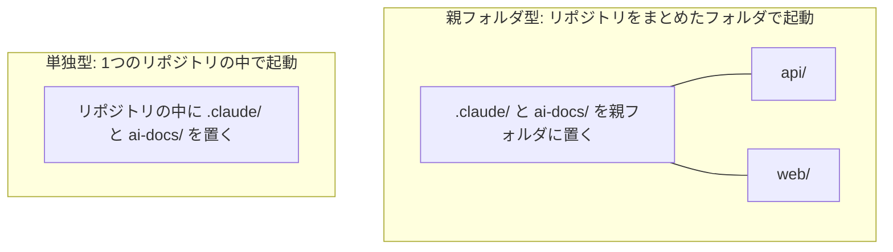
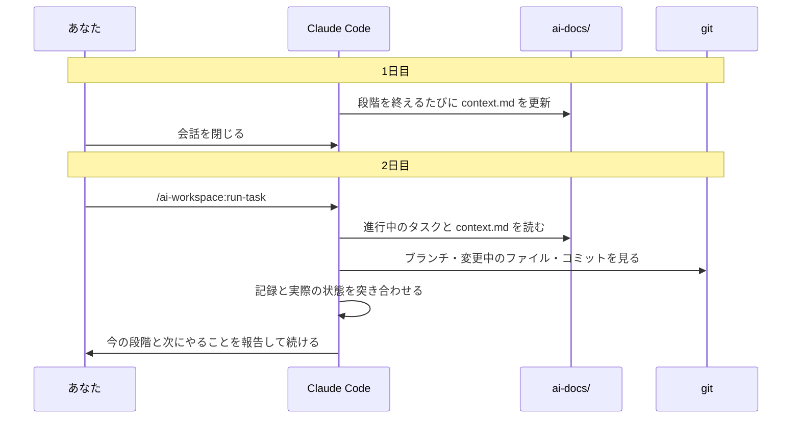
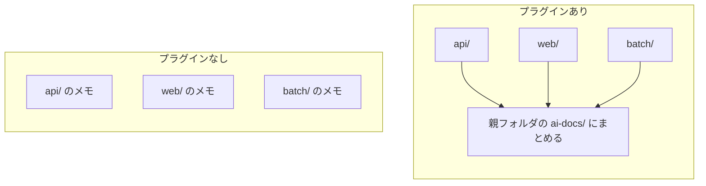
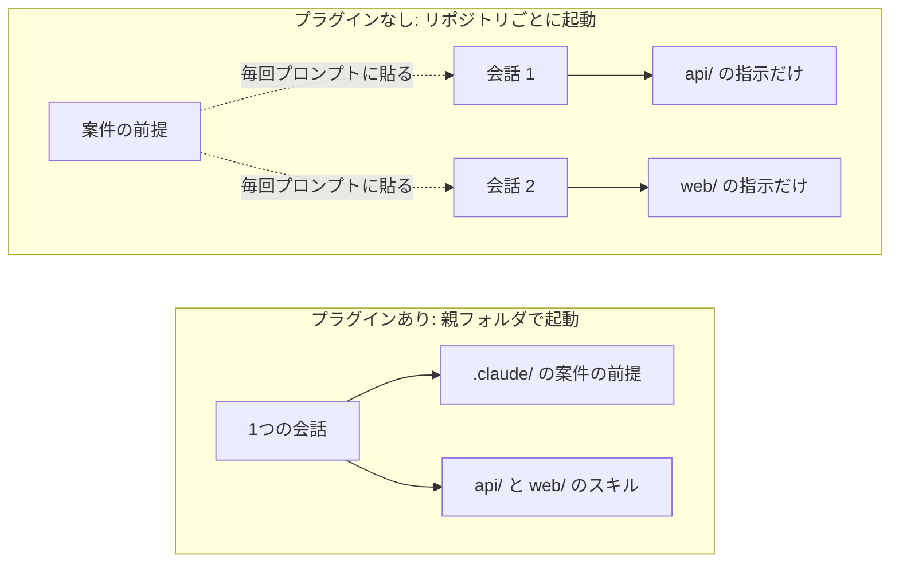
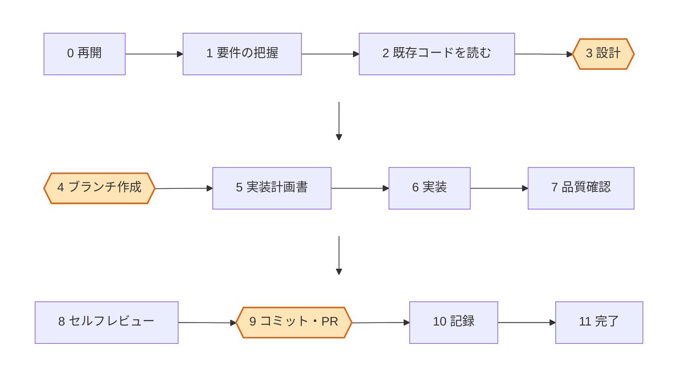
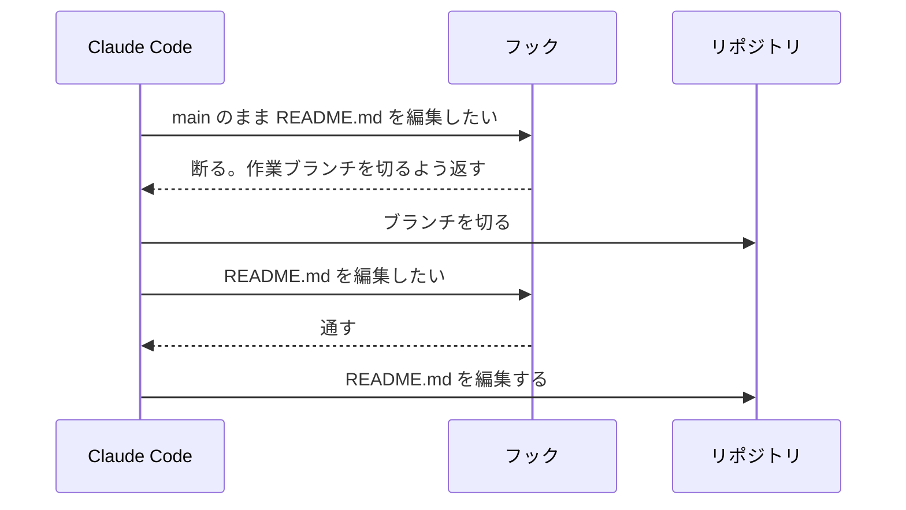
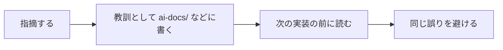

# ai-workspace

Claude Code がタスクを受け取ってから完了まで進めるプラグインです。1つのリポジトリでも、複数のリポジトリをまとめたフォルダでも使えます。

## 入れ方

事前に `jq` を入れておいてください（macOS なら `brew install jq`）。そのうえで、Claude Code で次の2行を打ちます。

```
/plugin marketplace add Sina-TehraniFard/ai-workspace
/plugin install ai-workspace@ai-workspace
```

## 最新にする

新しい版が出たら、各 PC のターミナルで次の2行を実行し、Claude Code を起動し直します。

```
claude plugin marketplace update ai-workspace
claude plugin update ai-workspace@ai-workspace
```

`~/.claude/plugins/cache/` の中のファイルは書き換えないでください。次の更新で上書きされます。また、どの版が入っているかが分からなくなります。直したいときは、このリポジトリに PR を出します。

## 使い方

使うのは `/ai-workspace:run-task` だけです。

1. リポジトリか、リポジトリをまとめたフォルダで `/ai-workspace:run-task` を打ちます。初回は準備のため、分からないことだけを質問されます
2. 準備が終わったら Claude Code を起動し直し、`/ai-workspace:run-task` にタスクの内容を貼ります
3. 続きを進めるときは、`/ai-workspace:run-task` を何も付けずに打ちます

## ワークスペースの形

起動した場所で、どちらの形になるかが決まります。



## このプラグインの設計

Claude Code だけで使うと困ることを、次のように解決しています。

### 1. 会話を閉じると、どこまで進んだかが分からなくなる

段階を終えるたびと中断する前に、タスクの進み具合を `ai-docs/tasks/<タスク>/context.md` に書きます。次の会話では、その記録を git の実際の状態と突き合わせてから続けます。記録と食い違えば、記録のほうを直します。

| `context.md` に書くこと | 例 |
|---|---|
| 時点 | 2026-11-05 |
| 段階 | 6 実装 |
| 現状サマリ | ブランチ docs/readme で README を書き換えた。未コミット |
| 次のアクション | ユーザーのレビューを受けて直す |



### 2. 複数のリポジトリがあると、記録が散らばる

親フォルダの `ai-docs/` 1か所に、すべてのリポジトリの記録を集めます。



### 3. 前提は共通なのに、リポジトリごとに閉じて、同じ指示を何度も書く

親フォルダで起動します。案件の前提は1回書けば済みます。各リポジトリのスキルも、1つの会話から使えます。



### 4. AI が自分の判断で先へ進んでしまう

段階表は、タスクを進める段階の一覧です。この順に進め、色の付いた段階では、まだ決まっていないことをあなたに聞いてから進みます。要件から決められないことがあるときや、手元での動作確認が要るときも止まります。段階表は書き換えられます。



### 5. 決まりを、AI の判断ではなく機械的に守らせたい

ワークスペースでは、決まりに反する操作をフックが止めます。フックは、Claude Code が操作する直前に動くプログラムです。

| 止める操作 | 止めたあとに求めること |
|---|---|
| 既定ブランチのままのファイル編集 | 作業ブランチを切る |
| 手順書を読まずに、コードや記録を書く | 手順書を読む |
| コードを書いた後、セルフレビューをせずにコミットする | セルフレビューをする |
| 指摘を受けたのに、教訓にせずに返事を終える | 指摘を教訓にする |

入力が指摘かどうかだけは、小さなモデルに判定させています。



### ほかに変わること

進行中のタスクと今の段階を、入力欄の上に表示します。受けた指摘は、次の流れで教訓にします。



## 含まれるコマンドとスキル

ほかのコマンドとスキルは、run-task が場面に応じて使います。

| コマンド | 役割 |
|---|---|
| `/ai-workspace:run-task` | タスクを受け取ってから完了まで、段階表の順に進める。初回は初期設定から始める |
| `/ai-workspace:init` | フォルダを調べ、ワークスペースとして初期設定する |
| `/ai-workspace:triage-issue` | 依頼を不具合か新しい機能かに分け、調査か設計をする |
| `/ai-workspace:implement` | 既存の書き方と過去の指摘を調べてから実装し、動作を確かめる |
| `/ai-workspace:review-changes` | 変更を、観点の違う複数のエージェントが並行してレビューする |
| `/ai-workspace:distill-lesson` | 受けた指摘を教訓にして `ai-docs/lessons.md` などに残す |
| `/ai-workspace:explain-stepwise` | 手順や概念を、段階を追って説明する |
| `/ai-workspace:do` | タスクにするほどではない質問や単発の作業をこなす |

| スキル | 役割 |
|---|---|
| `ai-workspace:ai-docs` | 調べた事実・決めたこと・タスクの進み具合を、決まった形で `ai-docs/` に書く |

## License

MIT
